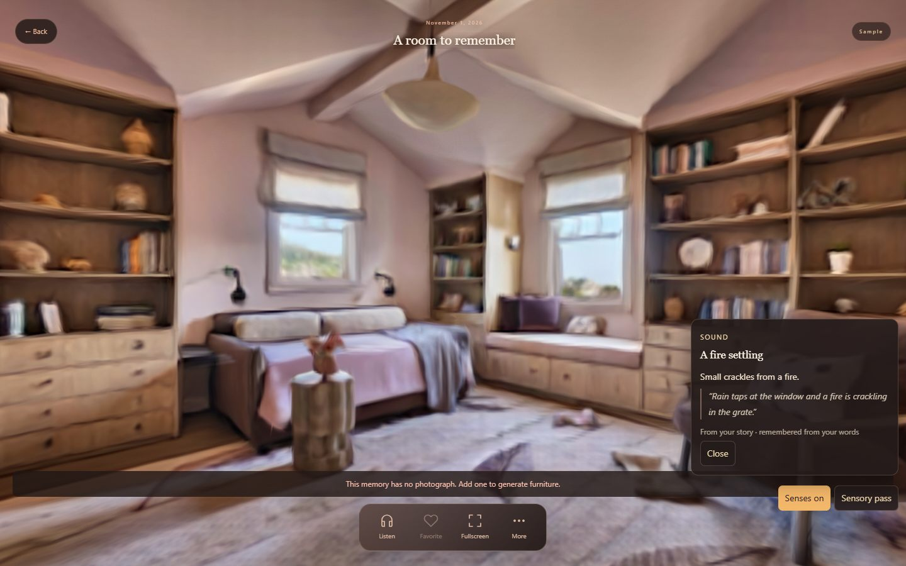

# MemoVerse

**A memory you can walk back into — and feel again.**

**Live demo:** <https://memoverse05.vercel.app>

MemoVerse turns a written journal entry into a navigable 3D room, then helps you
revisit it. Built for the *sensation* theme: the room you made from your words
remembers its senses back.

## The sensory memory layer



Write an entry — rain at the window, woodsmoke in the air, cold boards, lamp
light — and the room surfaces those senses one at a time. Each cue is copied
from the writer's own sentence and shows that sentence beside it, so the
interface never invents a smell or a sound the writer did not put there.

- **Evidence cards** — every cue carries a verbatim quote from the story or a
  placed memory anchor.
- **Sensory pass** — steps through every sense found in the entry.
- **Senses on** — seven synthesized Web Audio beds (rain, fire, wind, birds,
  waves, hum, music), optional haptics, and a warm/cool tint for temperature.
- **Deterministic and free** — a lexicon in `backend/sensory.py`; no LLM, no
  paid calls, no external service.

### Try it without an account

1. **Explore Memories** → **Continue exploring without signing in**.
2. Journal menu → **Try a Demo**.
3. The sample room opens, labelled **Sample**. Press **Sensory pass**, then
   **Senses on**.

Read the full write-up, API contract and limitations in
[docs/SENSORY_MEMORY.md](docs/SENSORY_MEMORY.md), and the timed judge
walkthrough in [docs/DEMO_SCRIPT.md](docs/DEMO_SCRIPT.md).

## Stack

- **Frontend** — React 19, Vite 8, React Three Fiber / Three.js, Spark Gaussian
  splats.
- **Backend** — FastAPI, Pydantic contracts, deterministic demo fallbacks.
- **Worlds** — World Labs Marble splats generated from a journaled photograph;
  enhancement and memory-anchor layers live in `backend/` and `frontend/src/`.
- **Data** — Supabase for accounts and journal storage (migrations in
  `frontend/supabase/`).

## Run locally

Two shells from the repository root:

```sh
# backend on :8000 (DEMO_MODE is on by default — no keys needed)
python -m uvicorn backend.main:app --reload --host 127.0.0.1 --port 8000

# frontend on :5173 (proxies /api to :8000)
npm --prefix frontend install
npm --prefix frontend run dev
```

Then open <http://127.0.0.1:5173/>.

For live generation, copy `backend/.env.example` to `backend/.env` and set the
server-side keys with `DEMO_MODE=false`. Only `backend/.env` is loaded; keys
must never appear in `VITE_*` variables or client code. More detail in
[backend/README.md](backend/README.md) and [frontend/README.md](frontend/README.md).

## Tests

```sh
PYTHONDONTWRITEBYTECODE=1 python -m unittest discover -s backend/tests -q
npm --prefix frontend test                          # frontend (node --test)
npm --prefix frontend run build                     # production build
```

## Deploy

Vercel builds from the repository root: the frontend is built by
`vercel.json`, and `/api/*` is rewritten to `api/index.py` (FastAPI). Pushing to
`main` deploys automatically.

## Further reading

- [docs/SENSORY_MEMORY.md](docs/SENSORY_MEMORY.md) — the sensation feature, end to end
- [docs/DEMO_SCRIPT.md](docs/DEMO_SCRIPT.md) — the 2½-minute judge demo, timed
- [docs/IMMERSIVE_EXPERIENCE.md](docs/IMMERSIVE_EXPERIENCE.md) — the immersive journal viewer
- [docs/WORLD_LABS_VIEWER.md](docs/WORLD_LABS_VIEWER.md) — the splat viewer
- [SCENE_SCHEMA.md](SCENE_SCHEMA.md) — the scene contract
