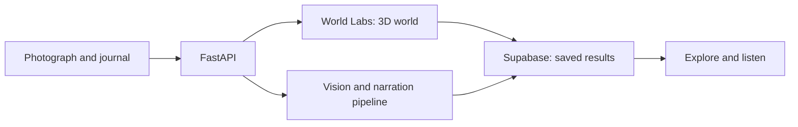

<div align="center">

# MemoVerse

### A memory you can walk back into — and hear again.

Turn a photograph and a journal entry into a saved 3D world with a personal audio story.

[**Open MemoVerse**](https://memoverse05.vercel.app/) · [Demo walkthrough](docs/DEMO_SCRIPT.md) · [Deployment guide](docs/VERCEL_DEPLOYMENT.md)

</div>

---

## Keep the moment. Step back inside it.

A childhood bedroom. An afternoon at your grandmother’s house. A place that still feels like home.

MemoVerse brings your photograph and the story you remember into one experience: a place to explore, words to listen to, and a journal you can return to.

## What you can do

| Feature | Experience |
| --- | --- |
| **Personal journal** | Save photographs, stories, dates and moods in your account. |
| **Photo to 3D** | Create an explorable World Labs memory from a saved photograph. |
| **MemoryCast** | Listen to a three-chapter narration grounded in your saved story and photo observations. |
| **Saved worlds and audio** | Reopen completed results without submitting another generation. |
| **Memory anchors** | Attach a remembered detail to an object in your room. |
| **Simple viewer controls** | Explore the world with listening and fullscreen controls close at hand. |

## Try MemoVerse

1. Open [memoverse05.vercel.app](https://memoverse05.vercel.app/) and choose **Explore Memories**.
2. Sign in with Google or email.
3. Choose **＋ New Memory**, add a photograph, and write what you remember.
4. **Save journal entry** to keep it, or choose **Create 3D world** to begin the world experience.
5. Return to your saved memory to explore its world or listen to available narration.

The journal menu also offers **Try a Demo**. The sample is a separate, labelled experience; it is not a reconstruction of your photograph.

> Generation depends on the configured providers, account allowance and available provider credits. A saved 3D world and its podcast are separate results: one can be available while the other is still preparing or needs attention.

## How it fits together



| Layer | Technology |
| --- | --- |
| Interface | React 19, Vite, CSS |
| 3D viewer | Three.js, React Three Fiber, Spark Gaussian splats |
| API | FastAPI, Pydantic |
| World generation | World Labs Marble |
| Image understanding and speech | OpenAI |
| Scene planning and script generation | DeepSeek and OpenAI, according to server configuration |
| Accounts and persistence | Supabase Auth, PostgreSQL and private Storage |
| Hosting | Vercel, with a same-origin Python API |

## Run locally

### Prerequisites

- Node.js 24 and npm.
- Python 3.12.
- A Supabase project configured for authentication and the project’s database/storage schema.
- Provider credentials for the live features you enable.

From the repository root:

```sh
# Install the Python dependencies.
python3 -m venv backend/.venv
backend/.venv/bin/python -m pip install -r backend/requirements-dev.txt

# Install the frontend dependencies.
npm ci --prefix frontend

# Create local configuration files.
cp backend/.env.example backend/.env
cp frontend/.env.example frontend/.env
```

Fill in the environment files using the **same Supabase project** for the frontend and backend. Then run these commands in separate terminals:

```sh
# Terminal 1 — API
backend/.venv/bin/python -m uvicorn backend.main:app \
  --reload --host 127.0.0.1 --port 8000
```

```sh
# Terminal 2 — frontend
npm --prefix frontend run dev
```

Open [localhost:5173](http://localhost:5173/). The development server proxies `/api` requests to the backend on port 8000. API documentation is available at [localhost:8000/docs](http://localhost:8000/docs).

### Configuration

| Location | Configuration |
| --- | --- |
| `frontend/.env` | `VITE_SUPABASE_URL` and the public `VITE_SUPABASE_PUBLISHABLE_KEY`. |
| `backend/.env` | `SUPABASE_URL`, `SUPABASE_SERVICE_ROLE_KEY`, and the provider keys for enabled features. |
| Server feature flags | `WORLD_GENERATION_ENABLED` and `MEMORYCAST_LIVE_ENABLED` control live world and narration generation. Database settings also apply. |

The backend loads **`backend/.env`**, rather than the repository-root `.env`; existing process environment variables take precedence. Keep OpenAI, DeepSeek, World Labs and Supabase service-role credentials server-side. `VITE_*` values are included in the browser bundle.

For an explicit local scene demo, set `DEMO_MODE=true` and `ALLOW_MOCK_FALLBACK=true`. These flags control scene-provider behavior; they do not replace Supabase sign-in or create a real World Labs result.

Database migrations live in [`frontend/supabase/`](frontend/supabase/). Review the existing database and apply only the required migrations in order. Historical repair scripts should not be blindly replayed against a live project.

## Project structure

```text
api/                   Vercel entry point for FastAPI
backend/               AI pipelines, saved-world and podcast APIs
backend/tests/         Backend and PostgreSQL regression tests
frontend/src/          Journal, account, audio and 3D interfaces
frontend/e2e/          Browser regression tests
frontend/supabase/     Database migrations and policies
docs/                  Architecture, operations and demo guides
vercel.json            Full-stack routing and build configuration
```

## Verify changes

```sh
backend/.venv/bin/python -m unittest discover -s backend/tests -q
npm --prefix frontend test
npm --prefix frontend run test:database
npm --prefix frontend run lint
npm --prefix frontend run build
```

Browser regressions are available through `npm --prefix frontend run test:browser` after installing the browser required by the Playwright configuration. Regression tests use synthetic fixtures and mocked providers; they do not demonstrate a successful paid production generation.

## Deployment

Vercel uses the **repository root**, builds `frontend/`, and routes `/api/*` through `api/index.py`. The intended production branch is **`main`**; feature branches use Preview deployments.

Configure production environment variables in Vercel and keep Supabase authentication URLs aligned with the deployed domain. A merge is not proof of a successful release: confirm the deployment’s commit SHA, status and `/health` response. Failed or rate-limited deployments leave the previous successful version live.

See the [full-stack deployment guide](docs/VERCEL_DEPLOYMENT.md) for configuration details.

## Explore the implementation

- [Demo walkthrough](docs/DEMO_SCRIPT.md)
- [Immersive journal experience](docs/IMMERSIVE_EXPERIENCE.md)
- [Persistent journal worlds](docs/PERSISTENT_JOURNAL_WORLDS.md)
- [World Labs viewer](docs/WORLD_LABS_VIEWER.md)
- [MemoryCast backend](backend/MEMORYCAST.md)
- [Scene contract](SCENE_SCHEMA.md)
